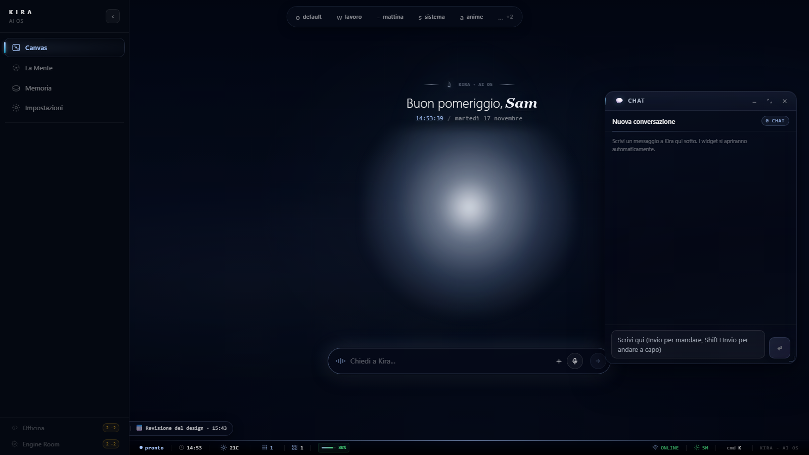
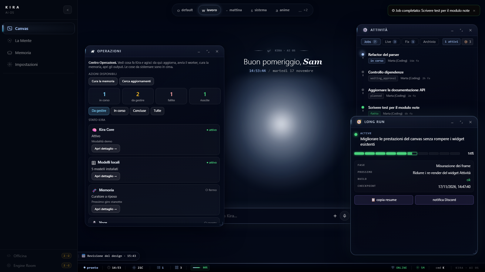
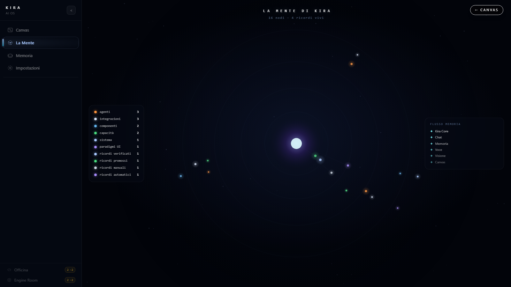

# Kairos Canvas

The UI shell of a personal, local-first **AI OS**: a canvas of draggable widgets
orbiting a **particle-hologram assistant** (Kira), with a command palette, voice
mode, workspace presets, a boot sequence and a small sound system.

This repository contains **only the frontend**. It runs standalone in
**demo mode** with invented data, so you can explore the whole interface without
any backend, model or account. (UI language: Italian.)

## Screenshots

Demo mode, invented data. Without a figure image the hologram core is a glowing orb (see below).



| Work layout: operations, jobs, long run | The assistant's mind map |
|---|---|
|  |  |

## Features

- Particle hologram core (`ParticleCoreCanvas`, `KiraCore`, `CognitiveOrb` / `CognitiveBackdrop`) that reacts to voice and chat state
- Draggable, resizable, minimizable widgets: chat, voice, weather, calendar, notes, memory (list + graph), supermemory, activity, operations, long run, agent flow, models, MCP, automation, turbo, news, briefing player, media, notifications, permissions, capability, settings, pomodoro, system status
- Command palette (`Ctrl+K`) and natural-language canvas commands ("apri note", "porta il meteo a destra", "salva layout come ...")
- Workspace switcher (`Ctrl+L`) and workspace tabs with saved layouts
- Boot sequence, sound effects (`soundManager`), notification HUD, status rail
- Voice UI (browser speech fallback), streaming chat, full-screen "Mind" and "Forge" views

## Quick start

```bash
npm install
npm run dev        # http://localhost:5173 - demo mode is the default
```

`npm run build` type-checks and produces a static bundle in `dist/`.

The name used in greetings and prompts lives in `src/config/user.ts` (`USER_NAME`, default `"Sam"`).

## Demo mode

`src/demo/demoFetch.ts` is installed in `src/main.tsx` before rendering. When
`VITE_DEMO` is not `"false"` it intercepts `window.fetch` for backend URLs
(`/api/...`, Ollama on `:11434`) and answers with the invented data in
`src/demo/demoData.ts` (tasks, calendar, notes, weather for a fictional city,
agents and jobs, notifications, a model list such as `llama3.1:8b` / `qwen2.5:7b`),
with small artificial delays. Chat replies are streamed from a short list of
canned answers. `EventSource` and `WebSocket` are replaced by harmless stubs.
Notes, memories and permissions can be edited during the session (in memory only).

## Connecting a real backend

The client code is untouched: it speaks plain HTTP/SSE to a backend exposing the
`/api/...` routes used in `src/` (chat streaming as NDJSON, models, notes, memory,
agents, ...). That backend is **not** part of this repository.

| Variable | Default | Meaning |
|---|---|---|
| `VITE_DEMO` | `true` | Set to `false` to disable the demo layer |
| `VITE_API_BASE` | _(empty)_ | Absolute backend URL; relative `/api/...` calls are rewritten to it (CORS required) |
| `VITE_API_PROXY` | `http://127.0.0.1:8787` | Dev/preview proxy target for `/api` when `VITE_API_BASE` is not set |

```bash
VITE_DEMO=false VITE_API_PROXY=http://127.0.0.1:8787 npm run dev
```

Copy `.env.example` to `.env.local` to persist them.

## Project structure

```
index.html
vite.config.ts, tailwind.config.ts, postcss.config.js, tsconfig.json
public/                      icon (add your own hologram figure here, see below)
src/
  main.tsx                   entry point, installs the demo layer
  App.tsx                    views, chat orchestration, shortcuts
  config/                    user name, model catalogue
  demo/                      demoData.ts, demoFetch.ts (demo mode)
  canvas/                    shell, store, registry, presets, palette, boot, widgets/
  components/                chat, voice, memory, agents panels, particle visuals, screens
  contexts/, hooks/, lib/    toasts, voice state, sounds, TTS/STT clients, model routing
  types/
```

## Hologram figure

The particle hologram samples a character image at `public/kira-figure.jpg` (bright figure on a dark
background) and, optionally, a grey-scale depth map at `public/kira-figure-depth.png`. The original
artwork is not distributed with this repository: add your own image there. Without it the core falls
back to a soft glowing orb. The boot greeting plays `public/voice/kira-greeting.wav` if present.

## Not included

The backend, agents, long-term memory store, voice engines and any private
integrations are not part of this repository.

## License

MIT - (c) 2026 sas0208. See [LICENSE](LICENSE).
